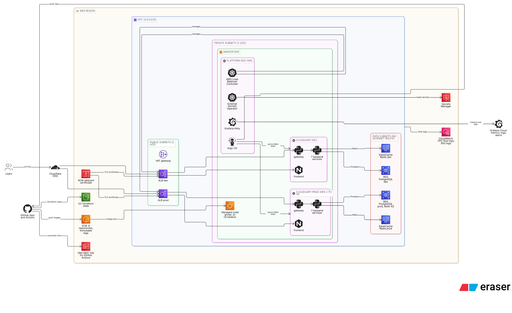
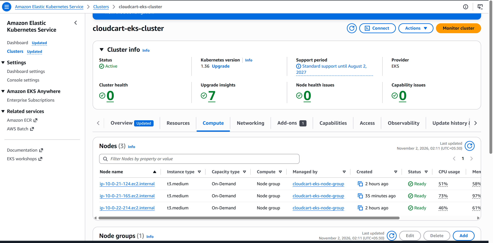
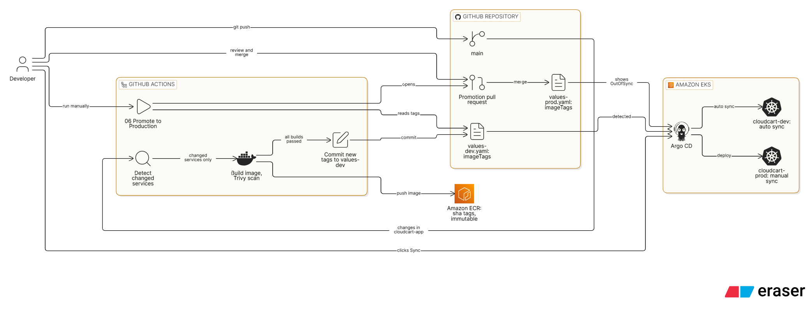
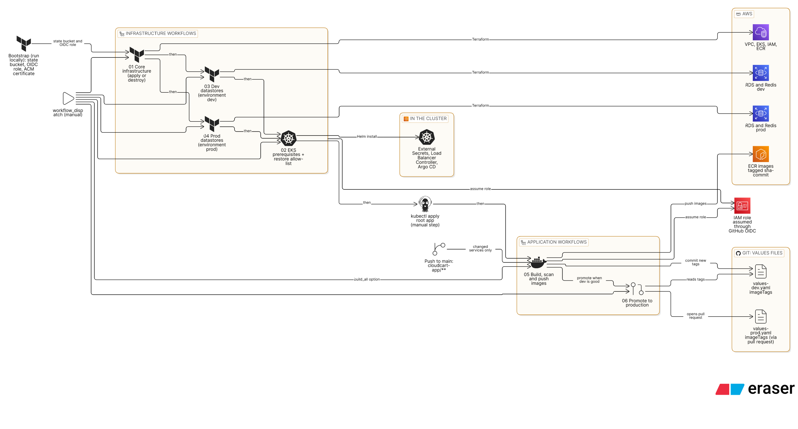

# CloudCart EKS


CloudCart is a containerized online retail application used as a **hands-on AWS, Kubernetes and DevOps portfolio project**. The application is intentionally simple; the goal is to design, provision and operate a realistic, production-oriented platform around it, end to end:

**Terraform** builds the AWS infrastructure, **GitHub Actions** builds and ships container images to **ECR**, **Argo CD** deploys them to **Amazon EKS** with a **Helm** chart, and **Grafana Cloud** (via **Grafana Alloy**) provides metrics, logs and alerts. Two environments (dev and prod) run side by side, and the whole stack can be created and destroyed on demand.



> The environment is created for testing and destroyed afterwards to keep AWS costs low, so the screenshots in this README come from live runs. See [Cost](#cost) and [Teardown](#teardown).

---

## Table of Contents

- [CloudCart EKS](#cloudcart-eks)
  - [Table of Contents](#table-of-contents)
  - [What this project demonstrates](#what-this-project-demonstrates)
  - [The application](#the-application)
  - [Architecture](#architecture)
  - [Repository structure](#repository-structure)
  - [CI/CD and GitOps](#cicd-and-gitops)
    - [Workflows](#workflows)
    - [Per-service release flow](#per-service-release-flow)
    - [Argo CD (app-of-apps)](#argo-cd-app-of-apps)
  - [Kubernetes and Helm](#kubernetes-and-helm)
  - [Observability](#observability)
  - [Security](#security)
  - [Prerequisites and one-time setup](#prerequisites-and-one-time-setup)
  - [Deployment guide](#deployment-guide)
  - [Teardown](#teardown)
  - [Cost](#cost)
  - [Design decisions and trade-offs](#design-decisions-and-trade-offs)
  - [Troubleshooting](#troubleshooting)
  - [Lessons learned](#lessons-learned)
  - [Roadmap](#roadmap)
  - [Author](#author)

---

## What this project demonstrates

| Area | What is implemented |
|------|---------------------|
| **Infrastructure as Code** | Modular Terraform (networking, security, IAM, EKS, RDS, ElastiCache, ECR), remote state in S3 with native locking, separate state per environment |
| **Networking** | Three-tier VPC: public (load balancers, NAT), private (EKS nodes and pods), data (databases, no internet route); VPC flow logs |
| **Kubernetes on AWS** | Amazon EKS with a managed node group, Pod Identity, EBS CSI driver, metrics-server, AWS Load Balancer Controller |
| **Delivery** | Per-service CI: only changed services are built, scanned (Trivy) and pushed to ECR; GitOps deployment with Argo CD; production promotion through a pull request |
| **Secrets** | AWS Secrets Manager synced into the cluster by External Secrets Operator, nothing sensitive in Git |
| **Security** | GitHub OIDC (no long-lived AWS keys), default-deny NetworkPolicies, non-root and read-only containers, private data tier, immutable image tags |
| **Observability** | Grafana Alloy shipping metrics, logs and events to Grafana Cloud, a custom dashboard and alert rules |
| **Operations** | Environment promotion, HPAs, PodDisruptionBudgets, ResourceQuota, repeatable teardown |

---

## The application

CloudCart is a small microservices storefront: a static frontend, an API gateway and seven backend services (Python / FastAPI).

| Service | Purpose | Data store |
|---------|---------|------------|
| `frontend` | Storefront UI served by nginx (non-root, port 8080) | none |
| `gateway` | Single API entry point; fans requests out to the services | none |
| `catalog` | Products | PostgreSQL |
| `identity` | Registration, login, sessions | PostgreSQL + Redis |
| `cart` | Shopping cart per session | Redis |
| `inventory` | Stock levels and reservations | PostgreSQL |
| `order` | Order creation; calls `inventory` and `payment` | PostgreSQL |
| `payment` | Payment authorization (simulated) | PostgreSQL |
| `notification` | Notification records | PostgreSQL |

Every backend exposes `/health` and Prometheus `/metrics`.

**Run it locally** (Docker Compose, no AWS needed):

```bash
cd cloudcart-app
cp .env.example .env
docker compose -f compose.production.yaml up --build
# open http://localhost:8080
```

 <!-- docs/images/app-storefront.png -->

 <!-- docs/images/app-cart.png -->

 <!-- docs/images/app-order-confirmation.png -->

---

## Architecture


The diagram source is in [`docs/architecture.eraser`](docs/architecture.eraser) (paste it into [eraser.io](https://www.eraser.io) to edit).

**Request path:** user, Cloudflare DNS, an internet-facing ALB (TLS from an ACM wildcard certificate), then the `frontend` and `gateway` pods in EKS, which talk to RDS and Redis in the data subnets. The ALB sends traffic straight to pod IPs (`target-type: ip`).

**Network layout** (`10.0.0.0/16`, two availability zones):

| Tier | CIDRs | Contains | Internet |
|------|-------|----------|----------|
| Public | `10.0.1.0/24`, `10.0.2.0/24` | ALBs, NAT gateway | via Internet Gateway |
| Private | `10.0.21.0/24`, `10.0.22.0/24` | EKS worker nodes and pods | outbound via NAT |
| Data | `10.0.31.0/24`, `10.0.32.0/24` | RDS PostgreSQL, ElastiCache Redis | none (no default route) |

**Environments:** dev and prod share one EKS cluster to keep costs down. They are separated by namespace (`cloudcart-dev`, `cloudcart-prod`), NetworkPolicies, a ResourceQuota on dev, and their own RDS instance, Redis cluster and secrets.

| | Dev | Prod |
|---|---|---|
| Hosts | `devshop.` / `devapi.` | `shop.` / `api.` (on your domain) |
| Replicas | 1 per service | HPA 2 to 10 (CPU 70%) |
| RDS (PostgreSQL 17) | `db.t3.micro`, single AZ, 1 day backups | `db.t3.small`, Multi-AZ, 7 day backups |
| Redis (7.1) | `cache.t4g.micro` | `cache.t4g.micro` |
| Argo CD sync | automatic | manual |

**Cluster:** managed node group of 2 to 3 `t3.medium` On-Demand nodes. EKS add-ons: VPC CNI (network policy enabled), CoreDNS, kube-proxy, Pod Identity agent, EBS CSI driver, metrics-server. Platform components installed by workflow 02: External Secrets Operator, AWS Load Balancer Controller and Argo CD.



---

## Repository structure

```
cloudcart-eks
├── .github/workflows        # 01-06 pipelines (infrastructure, cluster add-ons, build, promote)
├── argocd                   # app-of-apps: root app, AppProject, child applications
├── bootstrap                # one-time: state bucket, GitHub OIDC role, ACM certificate
├── cloudcart-app            # frontend, gateway and seven services (+ Docker Compose for local runs)
├── docs                     # architecture diagrams (Eraser source) and screenshots
├── kubernetes
│   ├── addons               # ClusterSecretStore for External Secrets
│   ├── helm-charts/cloudcart  # the application chart (values per environment)
│   └── monitoring           # Grafana Alloy values, secret sync, dashboard and alert rules
└── terraform
    ├── core-infra           # VPC, EKS, IAM, ECR
    ├── environments         # dev and prod: RDS + Redis + their secrets
    └── modules              # networking, security, iam, eks, database, cache, ecr
```

---

## CI/CD and GitOps



Diagram source: [`docs/cicd-flow.eraser`](docs/cicd-flow.eraser).

### Workflows

| # | Workflow | Trigger | What it does |
|---|----------|---------|--------------|
| 01 | Core infrastructure | manual (`apply` / `destroy`) | VPC, subnets, EKS, node group, IAM, ECR with Terraform |
| 02 | EKS prerequisites | manual | Temporarily allows the runner IP on the EKS endpoint, installs External Secrets, AWS Load Balancer Controller and Argo CD, then restores the allow-list |
| 03 | Dev datastores | manual (`apply` / `destroy`) | RDS, ElastiCache and secrets for dev |
| 04 | Prod datastores | manual (`apply` / `destroy`) | Same for prod (Multi-AZ RDS) |
| 05 | Build and push images | push to `main` (`cloudcart-app/**`) or manual | Detects changed services, builds, scans, pushes to ECR, commits the new tags to `values-dev.yaml` |
| 06 | Promote to production | manual | Copies the dev `imageTags` into `values-prod.yaml` and opens a pull request |

Workflows authenticate to AWS with **GitHub OIDC**, so there are no stored AWS keys.



### Per-service release flow

1. A push to `main` that touches `cloudcart-app/**` starts workflow 05.
2. **Detect:** `dorny/paths-filter` works out which services changed. Unchanged services are never rebuilt.
3. **Build, scan, push:** each changed service is built, scanned with Trivy (the run fails on fixable CRITICAL vulnerabilities) and pushed to ECR as `cloudcart/<service>:sha-<commit>`. ECR tags are immutable.
4. **Deploy to dev:** only the changed services' lines in the `imageTags` block of `values-dev.yaml` are updated and committed. Argo CD syncs dev automatically, and Kubernetes only rolls the Deployments whose image changed.
5. **Promote:** workflow 06 copies the `imageTags` block from dev to prod and opens a pull request. Merging it makes Argo CD show `cloudcart-prod` as OutOfSync, and a human clicks **Sync**. Prod therefore always receives exactly the images that were tested in dev; nothing is rebuilt.

`imageTags` holds one tag per service, so each service is released independently.

 <!-- docs/images/github-build-run.png -->

 <!-- docs/images/github-promotion-pr.png -->

 <!-- docs/images/aws-ecr-repositories.png -->

### Argo CD (app-of-apps)

`argocd/bootstrap/root-app.yaml` is applied once by hand. From then on everything under `argocd/apps/` is managed from Git: the `cloudcart` AppProject, `cloudcart-dev`, `cloudcart-prod`, the Grafana monitoring stack and its secret sync. Every Application carries the Argo CD resource finalizer, so deleting the root app removes the workloads (and the load balancers they created) cleanly.

 <!-- docs/images/argocd-applications.png -->

 <!-- docs/images/argocd-dev-resource-tree.png -->

 <!-- docs/images/argocd-prod-outofsync.png -->

---

## Kubernetes and Helm

One chart (`kubernetes/helm-charts/cloudcart`) deploys everything; `values-dev.yaml` and `values-prod.yaml` hold the differences.

| Feature | Detail |
|---------|--------|
| Images | `<ECR registry>/cloudcart/<service>:<imageTags.service>` |
| Secrets | `ExternalSecret` objects pull the database and Redis credentials from Secrets Manager into `postgresql-secret` and `redis-secret` |
| Scaling | HPA per service in prod (2 to 10 replicas), metrics-server for CPU |
| Availability | PodDisruptionBudget (`maxUnavailable: 1`) per service, soft topology spread across nodes and zones |
| Pod hardening | non-root user, `seccompProfile: RuntimeDefault`, no privilege escalation, all capabilities dropped, read-only root filesystem with a 64Mi `/tmp` volume, no service account token mounted |
| Network | default-deny NetworkPolicies plus an explicit allow-list per service (ALB to frontend and gateway, gateway to services, services to RDS and Redis only, Alloy scrape) and DNS egress |
| Guard rails | ResourceQuota on the dev namespace so a mistake there cannot starve prod (dev and prod share the cluster) |
| Metrics | pods carry `k8s.grafana.com/scrape` annotations so Grafana Alloy scrapes `/metrics` |

---

## Observability

[Grafana Alloy](https://grafana.com/docs/alloy/latest/) runs in the cluster through the `k8s-monitoring` Helm chart (managed by Argo CD) and ships to **Grafana Cloud**:

- **Metrics:** cluster and node metrics, kube-state-metrics, and the services' own `/metrics` (request rate, errors, latency)
- **Logs:** all pod logs to Loki, labelled by namespace, pod, app and environment
- **Events:** Kubernetes events

Credentials come from Secrets Manager (`cloudcart/grafana-cloud/alloy`) via External Secrets.

In [`kubernetes/monitoring/grafana`](kubernetes/monitoring/grafana):

- `cloudcart-dashboard.json`: *CloudCart / Overview* (replicas, request rate, 5xx rate, p95 latency, CPU, memory, restarts, error logs)
- `alert-rules.yaml`: three alerts (5xx rate above 5%, container restarting, deployment unavailable)

 <!-- docs/images/grafana-dashboard.png -->

 <!-- docs/images/grafana-alerts.png -->

 <!-- docs/images/grafana-logs.png -->

 <!-- docs/images/grafana-k8s-monitoring.png -->

---

## Security

| Layer | Control |
|-------|---------|
| CI to AWS | GitHub OIDC federation, trust limited to this repository's `main` branch and the `dev` / `prod` environments; no long-lived keys |
| Network | Private subnets for workloads, isolated data subnets with no internet route, least-privilege security groups, VPC flow logs (rejected traffic) |
| EKS endpoint | Private endpoint for the nodes; public endpoint restricted to an IP allow-list. CI adds its runner IP only while a workflow runs and always restores the list |
| In the cluster | Default-deny NetworkPolicies, non-root and read-only containers, no API token mounted into pods, namespace isolation |
| Secrets | AWS Secrets Manager as the source of truth, External Secrets Operator with Pod Identity; nothing sensitive in Git |
| Images | Private ECR, scan on push, Trivy gate in CI, immutable tags, non-root images |
| Data | RDS and Redis in the isolated data tier, reachable only from the cluster; ElastiCache encrypted at rest; automated RDS backups |
| Transport | TLS at the ALB with an ACM certificate |

**Known limitations** (also on the [Roadmap](#roadmap)): the CI role currently has broad permissions and should be reduced to least privilege; RDS storage encryption is not enabled yet; Redis traffic inside the VPC is not encrypted (the application does not support TLS yet).

---

## Prerequisites and one-time setup

**Tools:** AWS CLI, Terraform (1.5 or newer), kubectl, Helm, Docker. **Accounts:** an AWS account with admin access for the bootstrap, a GitHub repository (this one, forked or cloned), a Cloudflare-managed domain, and a free [Grafana Cloud](https://grafana.com/products/cloud/) stack.

1. **Bootstrap** (run locally with admin credentials). Creates the Terraform state bucket, the GitHub OIDC provider and role, and the ACM wildcard certificate (validated through Cloudflare):

   ```bash
   cd bootstrap
   cp terraform.tfvars.example terraform.tfvars   # region, bucket name, "owner/repo", branch, Cloudflare token + zone, domain
   terraform init && terraform apply
   ```

   `github_repo_path` must be exactly `owner/repo`. Note the outputs `oidc_role_arn` and `tls_certificate_arn`.

2. **GitHub repository variables** (Settings, Secrets and variables, Actions, Variables):

   | Variable | Value |
   |----------|-------|
   | `OIDC_ROLE_ARN` | `oidc_role_arn` from the bootstrap output |
   | `AWS_REGION` | e.g. `us-east-1` |
   | `EKS_ADMIN_ARN` | IAM user or role that should get cluster admin |

3. **GitHub settings:**
   - Create the **Environments** `dev` and `prod` (workflows 03 and 04 use them).
   - Settings, Actions, General: tick **Allow GitHub Actions to create and approve pull requests** (needed by workflow 06).
   - If `main` is protected, allow the GitHub Actions bot to push (workflow 05 commits image tags).

4. **Certificate ARN:** put `tls_certificate_arn` into the `alb.ingress.kubernetes.io/certificate-arn` annotation of `values-dev.yaml` and `values-prod.yaml`, and check the hostnames.

5. **Grafana Cloud:** put your stack's Prometheus and Loki push URLs into `kubernetes/monitoring/k8s-monitoring/values.yaml`, then create this secret in AWS Secrets Manager (it survives teardown, so you only do it once):

   ```bash
   aws secretsmanager create-secret --name cloudcart/grafana-cloud/alloy --secret-string \
     '{"prom_username":"<metrics id>","loki_username":"<logs id>","token":"<access policy token: metrics:write, logs:write>"}'
   ```

6. **Terraform inputs:** the workflows copy each `terraform.tfvars.example` to `terraform.tfvars`, so edit the `.example` files (region, project name, `office_ips`, sizes) before running them.

---

## Deployment guide

Run the workflows from the **Actions** tab in this order.

| Step | Action | Result |
|------|--------|--------|
| 1 | Run **01 Core infrastructure** (`apply`) | VPC, EKS, ECR, IAM (about 15 to 20 minutes) |
| 2 | Run **03 Dev datastores** and **04 Prod datastores** (`apply`) | RDS, Redis and the secrets |
| 3 | Run **02 EKS prerequisites** | External Secrets, Load Balancer Controller, Argo CD |
| 4 | Configure `kubectl` (your IP must be in `office_ips`) and apply the root app | Argo CD creates all other applications |
| 5 | Run **05 Build and push images** with `build_all` ticked | All nine images in ECR, dev tags committed, dev deployed |
| 6 | Create the DNS records in Cloudflare | `devshop` / `devapi` point to the dev ALB |
| 7 | Run **06 Promote to production**, merge the pull request, then **Sync** `cloudcart-prod` in Argo CD | Prod deployed |
| 8 | Import the Grafana dashboard and alert rules | Monitoring ready |

```bash
# step 4
aws eks update-kubeconfig --region us-east-1 --name <cluster-name>
kubectl apply -f argocd/bootstrap/root-app.yaml
kubectl -n argocd port-forward svc/argocd-server 8080:80        # then open http://localhost:8080
kubectl -n argocd get secret argocd-initial-admin-secret -o jsonpath='{.data.password}' | base64 -d

# step 6: find the ALB hostnames
kubectl get ingress -A
```

Create a CNAME for each hostname (`devshop`, `devapi`, `shop`, `api`) pointing at the matching ALB address. The ALB address changes every time the environment is rebuilt, so DNS is the one manual step per cycle (moving DNS to Route 53 with ExternalDNS is on the roadmap).

**Grafana (step 8):** Dashboards, New, Import, upload `kubernetes/monitoring/grafana/cloudcart-dashboard.json`. Load the alert rules with `mimirtool rules load` (see the header of `alert-rules.yaml`) or recreate the three rules in Alerting.

**Afterwards:** every code change to a service flows through workflow 05 (dev) and workflow 06 (prod) with no further manual steps.

---

## Teardown

Resources created by Kubernetes (the ALBs) are not in Terraform, so the order matters:

1. Remove the workloads and load balancers through Argo CD:
   ```bash
   kubectl delete application root -n argocd        # cascades to every child application
   kubectl get applications -n argocd               # wait until empty
   kubectl get ingress -A                           # wait until empty
   aws elbv2 describe-load-balancers --query 'LoadBalancers[].LoadBalancerName'   # wait until the k8s-* ALBs are gone
   ```
2. Run **04 Prod datastores** (`destroy`), then **03 Dev datastores** (`destroy`).
3. Run **01 Core infrastructure** (`destroy`).
4. Optional: `terraform destroy` in `bootstrap` to remove the state bucket, OIDC role and certificate.

If an Argo CD application sticks in `Deleting`:
`kubectl patch application <name> -n argocd --type json -p '[{"op":"remove","path":"/metadata/finalizers"}]'`.

Things that outlive a teardown on purpose: the Grafana secret in Secrets Manager, and the EKS control-plane CloudWatch log group (created by EKS itself, not Terraform).

---

## Cost

Rough on-demand prices in `us-east-1` while everything is running (estimates, check current AWS pricing):

| Item | About per hour |
|------|----------------|
| EKS control plane | $0.10 |
| 2x `t3.medium` nodes | $0.08 |
| NAT gateway (plus data) | $0.045 |
| 2x Application Load Balancer | $0.045 |
| RDS dev + prod (Multi-AZ) | $0.09 |
| ElastiCache (2 nodes) | $0.03 |
| **Total** | **roughly $0.40** (about $10 per day) |

Because the stack is destroyed after each test session, a typical session costs a few dollars. VPC flow logs only record rejected traffic to keep CloudWatch costs low, and Grafana Cloud runs on the free tier (watch the active-series limit when both environments run).

---

## Design decisions and trade-offs

| Decision | Why | What I would change in real production |
|----------|-----|----------------------------------------|
| Dev and prod in one cluster | Cost | Separate clusters or accounts; here isolation is namespaces, NetworkPolicies and quotas |
| Public EKS endpoint with an IP allow-list; CI temporarily adds its runner IP | Hosted runners cannot reach a private endpoint | Private endpoint with self-hosted runners in the VPC or a VPN |
| Argo CD auto-sync for dev, manual sync for prod, promotion by pull request | Fast feedback in dev, human gate and audit trail for prod | Required reviewers and status checks on the promotion PR |
| One image tag per service (`imageTags`) | Services release independently, only changed services roll | Same, plus image signing |
| Base images are not rebuilt unless their code changes | Keeps CI fast | Scheduled rebuild to pick up patched base images |
| Prod RDS deletion protection off, no final snapshot | The environment is destroyed after every test | Protection on, final snapshot on |
| Redis without in-transit TLS | The application does not support it yet | TLS plus AUTH |
| Grafana Cloud instead of self-hosted Prometheus | Less to operate, free tier | Same, or self-hosted for data residency |
| Terraform state in S3 with native locking | No DynamoDB table needed | Same |
| ECR tags immutable | A tag always means the same image | Same |

---

## Troubleshooting

| Symptom | Cause | Fix |
|---------|-------|-----|
| Workflow 03 / 04 fails at "Assume the AWS role" | Jobs that use a GitHub *Environment* present a different OIDC subject (`...:environment:dev`) | Add `repo:<owner>/<repo>:environment:dev` and `:prod` to the IAM role's trust policy |
| Pods in `CreateContainerConfigError` | Secret key names in the Deployment do not match the keys in the Kubernetes secret (they are `DATABASE_URL` and `REDIS_URL`) | `kubectl -n <ns> get secret postgresql-secret -o jsonpath='{.data}'` and compare with the Deployment |
| Pods in `InvalidImageName` | `imageTags` is empty because no image was built yet | Run workflow 05 with `build_all` |
| `kubectl` times out | Your IP is not in the EKS endpoint allow-list | Add it to `office_ips` and re-run workflow 01 |
| Terraform destroy hangs on the VPC | Load balancers created by Kubernetes still exist | Follow the [Teardown](#teardown) order |
| Argo CD shows an ExternalSecret as degraded | The AWS secret path, Pod Identity role or IAM scope is wrong | `kubectl describe externalsecret -n <ns>` |

---

## Lessons learned

- **OIDC subjects change with Environments.** A job with `environment:` no longer presents the branch subject, so the trust policy needs an entry per environment.
- **External Secrets keeps key names exactly as they are in Secrets Manager.** One lowercase versus uppercase difference was enough to break every pod, so I now verify every `secretKeyRef` against the real keys when I render the chart.
- **Never replace an allow-list, extend and restore it.** My first version of the EKS endpoint step overwrote the office IP. The final version adds the runner, records the original list first, and restores it in a separate job that always runs.
- **Edit files surgically in pipelines.** Rewriting a values file with `awk` added a trailing newline and produced a noisy pull request; `sed -i` on just the tag lines keeps diffs clean.
- **Read-only root filesystems need planning.** The frontend needed a non-root nginx image and a symlink to `/tmp` for its generated `config.js`.
- **Resources created by controllers are invisible to Terraform.** ALBs made by the Load Balancer Controller must be removed before the VPC, which is why every Argo CD application has a finalizer and teardown has a fixed order.
- **Per-service immutable tags beat one global tag.** They make releases independent and every deployment traceable to a commit.

---

## Roadmap

- [x] Terraform bootstrap (state, OIDC, certificate) and modular infrastructure
- [x] Three-tier VPC, EKS, RDS, ElastiCache, ECR, flow logs
- [x] Secrets Manager with External Secrets and Pod Identity
- [x] Helm chart with hardening, NetworkPolicies, PDBs, HPAs, quota
- [x] Per-service build, scan and push pipeline
- [x] Argo CD app-of-apps with promotion by pull request
- [x] Grafana Cloud metrics, logs, dashboard and alerts
- [ ] Reduce the CI role to least privilege
- [ ] Pull request checks: `terraform fmt` / `validate`, `tflint`, `checkov`, `helm lint`, `kubeconform`, `hadolint`
- [ ] DNS automation (Route 53 with ExternalDNS)
- [ ] Enable RDS storage encryption
- [ ] Redis TLS
- [ ] Scheduled rebuild of base images
- [ ] Permissions boundary for the CI role

---

## Author

**Mohit**
GitHub: [@mohitbnt](https://github.com/mohitbnt)